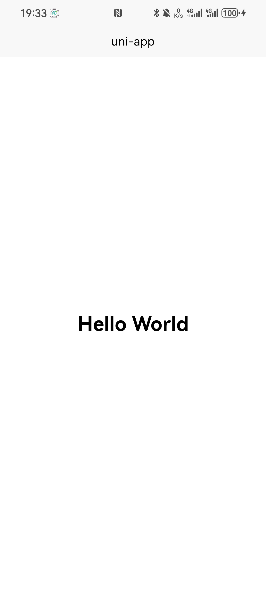

# hello-uniapp

课程作业：uni-app 第一个工程 —— 用声明式 UI 写一个 Hello World 页面，并运行到真机。

## 开发环境

| 项 | 版本 / 说明 |
|---|---|
| 开发工具 | HBuilderX 5.26（App 开发版） |
| 框架 | uni-app（Vue 3） |
| 运行设备 | 华为 P60（Android / HarmonyOS 4.x，真机） |
| 调试方式 | HBuilder 标准基座 |

## 目录结构

```
hello_uniapp/
├─ pages/
│  └─ index/
│     └─ index.vue          ← 页面：Hello World
├─ static/                  ← 静态资源（图片等，不参与编译）
├─ App.vue                  ← 应用入口：全局生命周期 + 全局样式
├─ main.js                  ← Vue 实例创建入口
├─ pages.json               ← 配置：页面路由 + 窗口样式
├─ manifest.json            ← 配置：应用名称 / 包名 / appid / 图标
├─ uni.scss                 ← 全局 SCSS 变量
└─ index.html               ← H5 端模板
```

### 关键文件说明

- **入口**：`main.js` 创建 Vue 实例，`App.vue` 承载应用级生命周期
- **配置**：`pages.json` 负责页面路由注册（新页面必须在此登记）；`manifest.json` 负责应用身份信息
- **页面**：`pages/index/index.vue` 单文件组件，`<template>` 描述视图

## 运行方法

1. HBuilderX 打开本目录
2. 手机开启「开发者选项 → USB 调试」，数据线连接电脑
3. 菜单：`运行 → 运行到手机或模拟器 → 运行到 Android App 基座`
4. 选择设备，等待基座安装完成

## 运行效果



## 小结

页面只做了一件事：把 "Hello World" 显示在屏幕正中。

```vue
<template>
  <view class="page"><text class="title">Hello World</text></view>
</template>
```

`<view>` 和 `<text>` 是 uni-app 的内置组件，最终会被编译成各端对应的原生控件（Android 上是 View / TextView）。
这体现了 uni-app「一套代码、多端编译」的思路：**开发者只描述界面长什么样，由框架负责翻译成目标平台的实现**。
